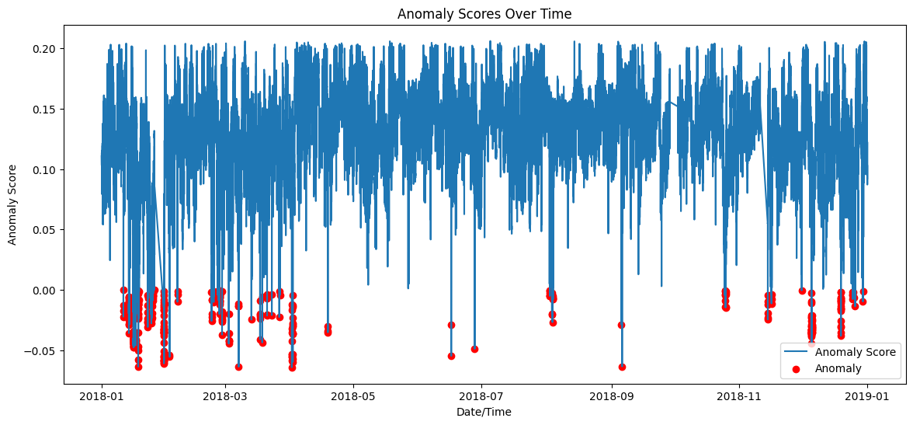
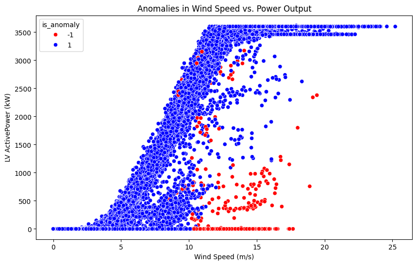
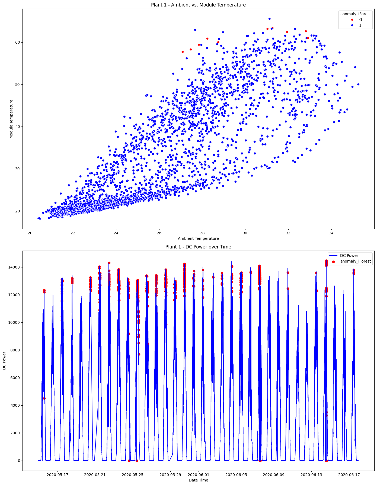
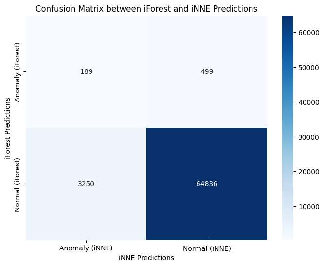

# Anomaly Detection for Solar and Wind Turbine Power Generation

A university machine-learning project that applies unsupervised anomaly detection to public wind-turbine SCADA data and public solar-plant data, using Python and scikit-learn.

> **Status:** academic coursework (Deakin University), not professional or production ML work. It has not been peer reviewed or published. Some methodological problems in the original submission are documented below and in [docs/technical-review.md](docs/technical-review.md).

## Author and context

Kudzai Shava, Master of Data Science, School of Information Technology, Deakin University. Sole author. The original report and notebooks are included as submitted, with only the cleanup edits listed under [Original work versus later changes](#original-work-versus-later-changes).

## Question and intended use

Can Isolation Forest and a nearest-neighbour distance score flag unusual operating observations in wind and solar generation data? The project detects **unusual current observations**. It does not predict future failures: there is no forecasting horizon, no failure labels and no failure evaluation.

## Data

Neither dataset is redistributed here; see [data/README.md](data/README.md) for sources, licence notes and download steps.

- **Wind:** [Wind Turbine SCADA Dataset](https://www.kaggle.com/datasets/berkerisen/wind-turbine-scada-dataset) (Berk Erisen, Kaggle). One turbine in Turkey, 50,530 ten-minute readings across 2018: active power, wind speed, wind direction and the manufacturer's theoretical power curve.
- **Solar:** [Solar Power Generation Data](https://www.kaggle.com/datasets/anikannal/solar-power-generation-data) (Ani Kannal, Kaggle). Two plants in India over 34 days: inverter-level generation and plant-level weather sensor readings at 15-minute intervals.

## What was implemented

| Area | Notebook | What the code does |
|---|---|---|
| Wind EDA | [wind_scada.ipynb](notebooks/wind_scada.ipynb) | Pair plot, correlations, time series, distributions |
| Wind anomaly detection | same | `IsolationForest` (100 trees, contamination 0.01) on four standardised features |
| Wind regression with an uncertainty filter | same | Linear Regression and Random Forest predicting active power; rows where per-tree prediction spread exceeds 0.1 are dropped (called "IDK" in the report) |
| Solar merge and features | [Solar_Power_Generation_Data.ipynb](notebooks/Solar_Power_Generation_Data.ipynb) | Weather and generation tables merged on `DATE_TIME` and `PLANT_ID`; `TEMP_DIFF` = module minus ambient temperature; standard scaling |
| Solar anomaly detection | same | `IsolationForest` (contamination 0.01) and a custom k-nearest-neighbour distance score (k=5, top 5% flagged; called "iNNE" in the report) for each plant |
| Detector comparison | same | Confusion matrix of the two detectors' flags for Plant 1 |
| Corrected wind regression | [wind_scada_revised.ipynb](notebooks/wind_scada_revised.ipynb) | Later portfolio-review revision (see below) |

## Results

There are no ground-truth anomaly or failure labels, so none of these figures measure detection accuracy.

- **Isolation Forest** flags a fixed share of rows because of the contamination setting. On Plant 1 (68,774 merged rows) that is 688 rows (1%). The flagged points can be inspected, but whether they are real faults is unknown.
- **Detector agreement (Plant 1):** 189 rows flagged by both, 499 by Isolation Forest only, 3,250 by the distance score only, 64,836 by neither. This is agreement between two unsupervised methods with different flag rates (1% and 5%), not accuracy. Re-running with different seeds changed the "both" count between about 166 and 189.
- **Original wind regression errors** (MSE about 1e-28 to 1e-31 for Linear Regression) are **not meaningful**: the target was included among the input features.
- **Revised wind regression** (target removed, time-ordered split, scaler fitted on training data), last 20% of rows as test:

| Model | MAE (kW) | RMSE (kW) | R² |
|---|---|---|---|
| Baseline: manufacturer power curve | 207.9 | 470.7 | 0.877 |
| Linear Regression | 221.3 | 414.5 | 0.905 |
| Random Forest (100 trees, seed 42) | 266.8 | 556.6 | 0.828 |

This is one turbine, one year and one split, with default settings. It shows that power can be estimated from wind conditions reasonably well, and that Random Forest did not beat Linear Regression here.

### Selected figures (from the original report)


*Wind: Isolation Forest scores over 2018. Red points are the lowest-scoring ~1% of rows. Clusters, such as January, show where unusual operation occurred in this dataset; their causes are not known.*


*Wind: flagged observations against the speed-power relationship.*


*Solar, Plant 1: flagged observations by temperature (top) and DC power over time (bottom).*


*Solar, Plant 1: agreement between Isolation Forest and the distance score. The axis labels say "iNNE", but the code is a k-nearest-neighbour distance score, not the published iNNE algorithm.*

## Limitations

- No labelled anomalies or failures, so detection quality is unmeasured.
- Method names in the report do not match the code: "iNNE" is a mean-kNN-distance score and "IDK" is the spread of Random Forest tree predictions. They are not the published iNNE or Isolation Distributional Kernel methods.
- Original wind regression had target leakage, a random split and a scaler fitted before splitting.
- Solar models are fitted and scored on the same data, with no seed set.
- Statements in the report about real-time use, reduced downtime or predictive maintenance are not tested by the code. Notebook run times come from Colab or local notebook sessions and say nothing about operational readiness.

Details are in [docs/technical-review.md](docs/technical-review.md).

## Repository structure

```
README.md
LICENSE                   MIT, code only (see Licensing)
requirements.txt          unpinned package list
notebooks/
  wind_scada.ipynb                       original work, cleaned paths
  Solar_Power_Generation_Data.ipynb      original work, cleaned paths
  wind_scada_revised.ipynb               later corrected regression
reports/                  public copy of the original report (email redacted)
images/                   figures taken from the report
data/README.md            data sources and download steps (data not included)
docs/technical-review.md  implementation audit and change log
```

## Setup and running

1. Download the data as described in [data/README.md](data/README.md) into `data/`.
2. Create an environment and install the packages:
   ```bash
   python3 -m venv .venv && source .venv/bin/activate
   pip install -r requirements.txt
   ```
3. Run each notebook from inside `notebooks/` (paths are relative to that folder), e.g. `jupyter nbconvert --to notebook --execute wind_scada_revised.ipynb`.

All three notebooks were executed end to end without errors in November 2026; environment details are in the technical review. The saved outputs in the original two notebooks come from the original Colab run and were left as they were.

## Original work versus later changes

- **Original (university submission; notebook logs show it was run in May 2024):** the report, and the logic and outputs of `wind_scada.ipynb` and `Solar_Power_Generation_Data.ipynb`.
- **Cleanup (2026, no logic changes):** removed private download links, made data paths relative, added a notes cell at the top of each notebook, redacted the author's email from the report PDF, added this documentation.
- **Portfolio-review revision (2026):** `wind_scada_revised.ipynb`. Clearly separate from the original results.

## Possible future improvements (not implemented)

- Seed and repeat the solar detectors, and report stability of the flagged sets.
- Use labelled or injected anomalies to evaluate detection.
- Implement iNNE properly (or use a library implementation) if it is to be named.
- Model solar power against irradiance and temperature, and flag large residuals.

## Licensing

- **Code** (notebook code, written by Kudzai Shava): MIT, see [LICENSE](LICENSE).
- **Report** (`reports/`): copyright the author; shared for reading. It is not covered by the MIT licence.
- **Datasets:** not included and not covered by this licence. Each remains subject to its original authors' terms on Kaggle.
- Notebook outputs include a few rows of dataset values and plots of them.
